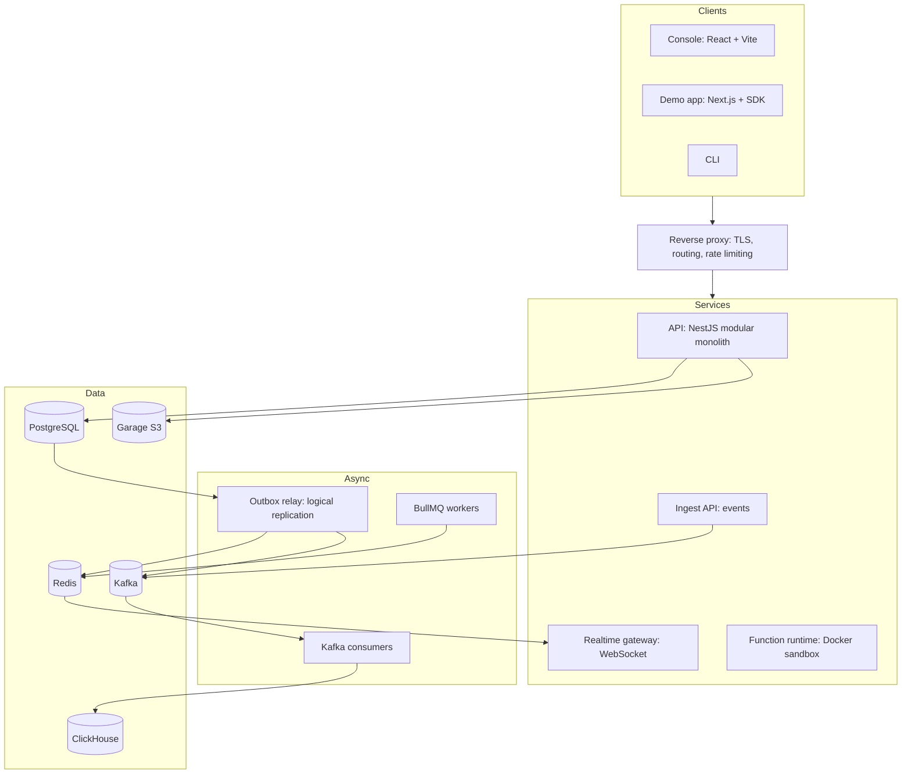

# OpenBase

A self-hosted, Firebase-like backend platform built from scratch as a system design study:
authentication, a realtime document database, security rules, storage, functions, hosting,
messaging, analytics and more, together with the infrastructure that runs them.

> **Status:** early development. Phase A (foundation) is in progress. See [Roadmap](#roadmap).

## Why

Firebase hides the hard parts behind an SDK. OpenBase rebuilds them in the open to make each
trade-off explicit: how realtime fan-out works, how security rules are evaluated, how an event
travels from a write to a subscriber, and how the system is observed, scaled and recovered.
Every significant decision is recorded as an [Architecture Decision Record](docs/adr/).

## Architecture (planned)

## Tech stack

| Area | Choice | Why |
| --- | --- | --- |
| Runtime | Node.js 26 LTS | Supported until April 2029 |
| Language | TypeScript 7 | Native compiler, much faster builds and editor feedback |
| Monorepo | pnpm workspaces + catalogs | Strict dependency isolation, one lockfile, one version source |
| Toolchain | mise | Pins Node.js and pnpm per repository |
| API | NestJS 12 | Modules and dependency injection for a large modular monolith |
| Database | PostgreSQL + Prisma 8 | ACID, JSONB documents, row-level security for tenant isolation |
| Realtime | WebSocket gateway, Redis pub/sub | Long-lived connections scaled separately from the API |
| Jobs | BullMQ | Retries with backoff, dead-letter queues |
| Object storage | Garage (S3 API) | Self-hosted, S3-compatible, presigned URLs |
| Events & analytics | Kafka, ClickHouse | High-volume event stream and columnar analytics |
| Frontend | React + Vite (console), Next.js (demo) | SPA admin console, SSR demo app |
| Observability | OpenTelemetry, Prometheus, Loki, Tempo, Grafana | Metrics, logs and traces across services |

## Repository structure

    apps/          deployable services and frontends (planned)
    packages/
      shared/      validation rules and types shared by server and clients
    docs/adr/      architecture decision records

## Getting started

Requirements: [mise](https://mise.jdx.dev), Docker.

    mise install
    pnpm install
    pnpm build

## Roadmap

- [ ] **Phase A, Foundation:** toolchain, monorepo, local infrastructure, API skeleton, CI
- [ ] **Phase B, Data core:** projects and tenancy, auth, document database, security rules, realtime, storage
- [ ] **Phase C, Server code and deploy:** observability, CLI, functions, hosting, messaging
- [ ] **Phase D, App management:** remote config, analytics, in-app messaging, crash reporting, performance, A/B testing
- [ ] **Phase E–F, Protection and data models:** App Check, AI Logic, Realtime Database, SQL Connect, Extensions
- [ ] **Phase G, Platform and production:** usage and billing, scaling, infrastructure as code, backup and recovery

## License

[MIT](LICENSE)
